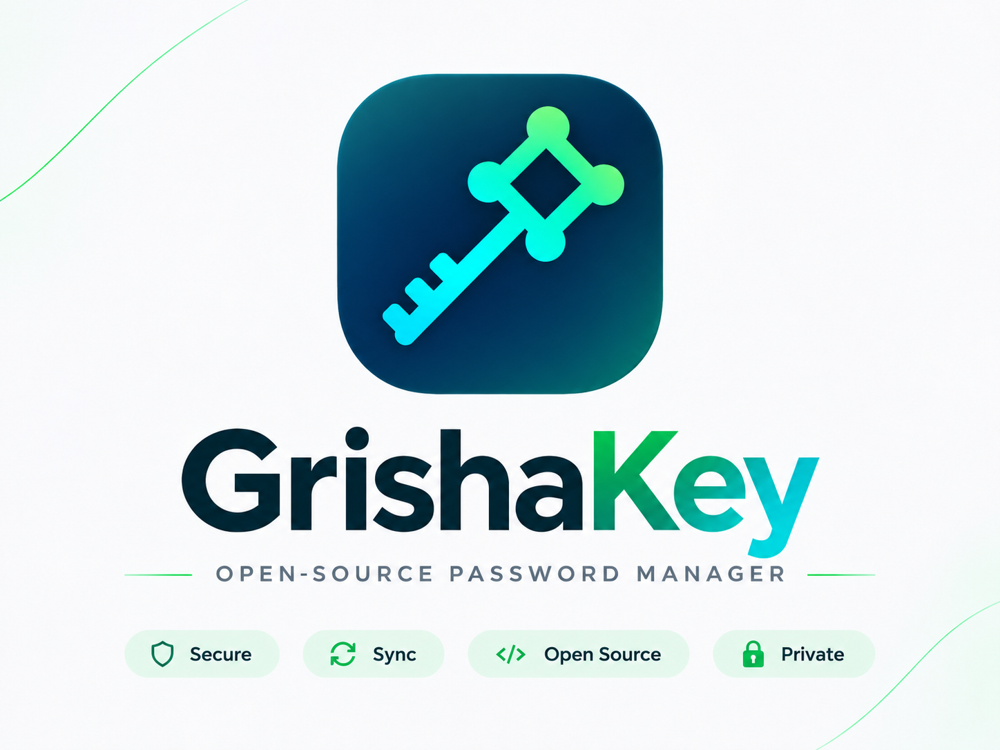
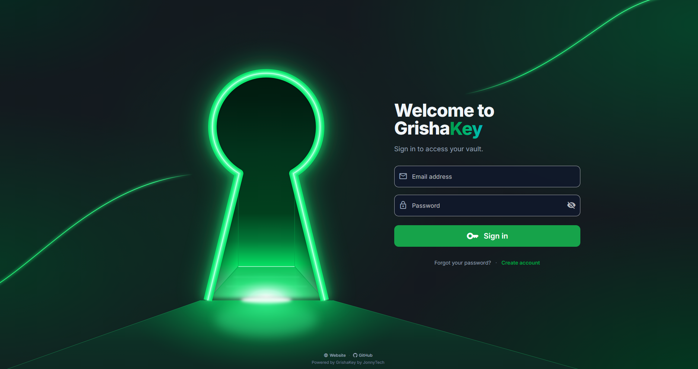
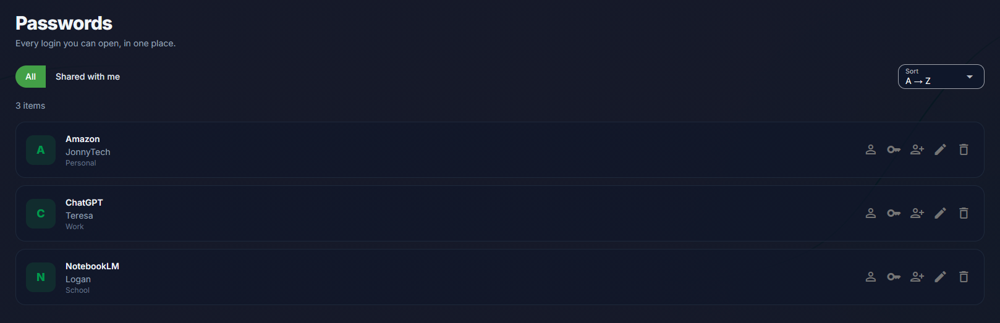
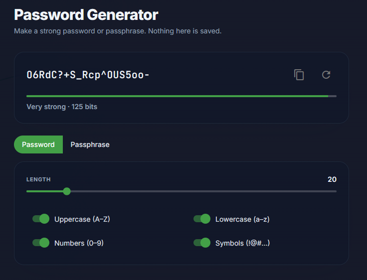
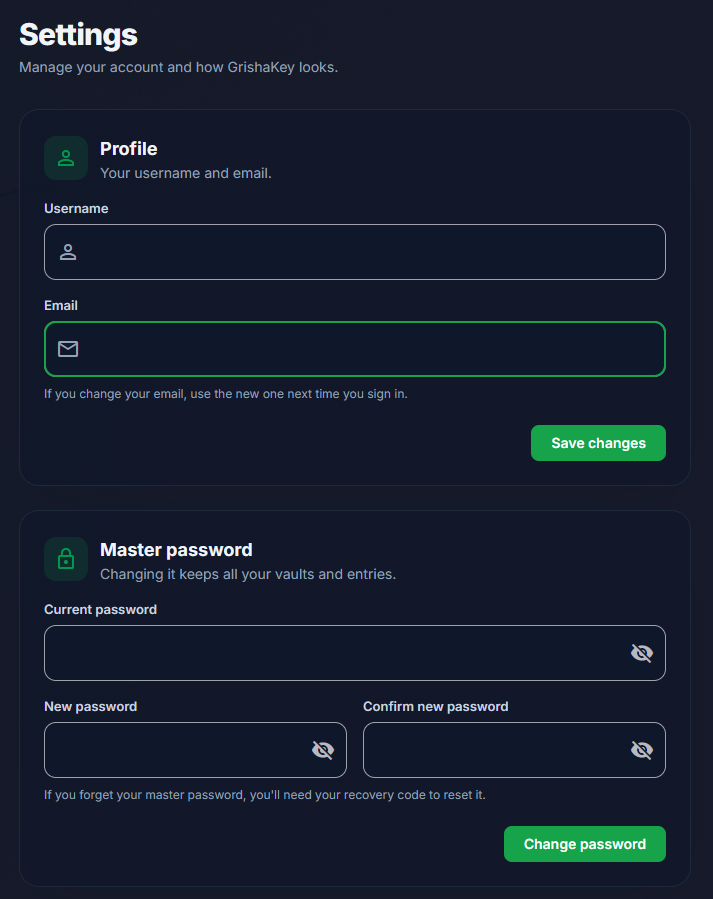
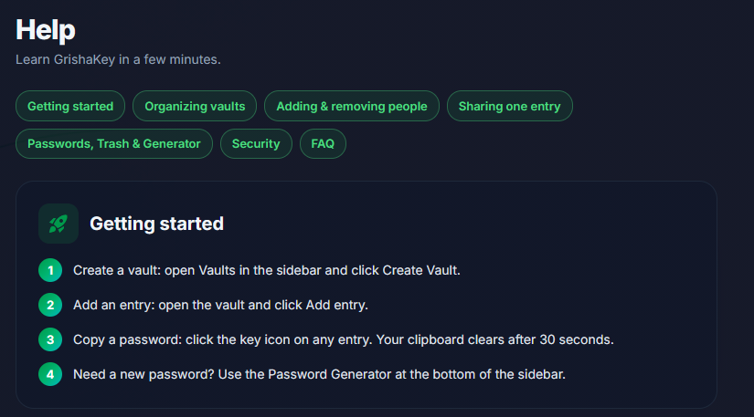
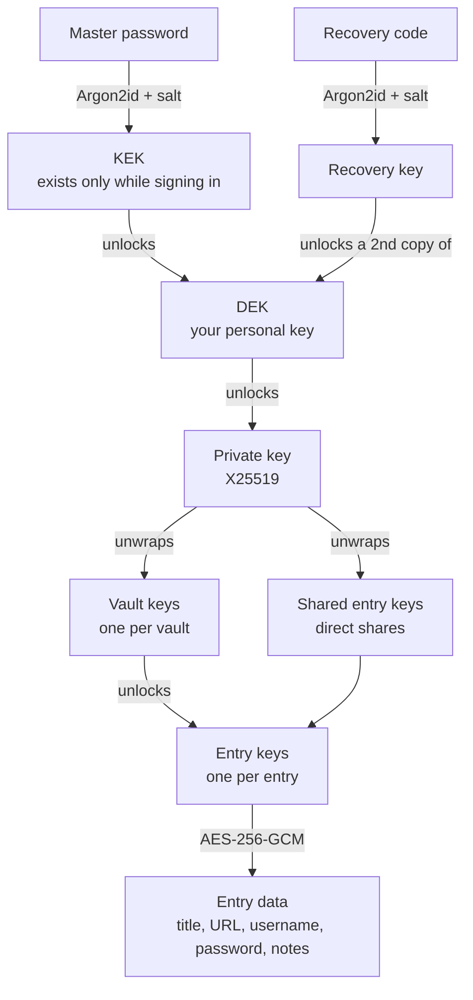
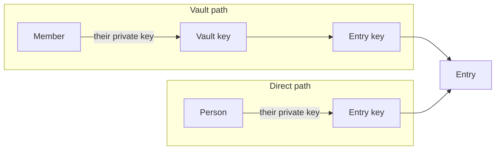

<div align="center">



[🌐 Website](https://grishakey.jonnytech.dev)

**A self-hosted password manager for teams, families, and organizations.**
Encrypted vaults, simple sharing, and a clean interface, built in Python.

<!-- SCREENSHOT: hero image (vaults dashboard). Save as docs/screenshots/dashboard.png -->


</div>

---

## Contents

- [What it is](#what-it-is)
- [Features](#features)
- [Screenshots](#screenshots)
- [Tech stack](#tech-stack)
- [How the encryption works](#how-the-encryption-works)
- [How sharing works](#how-sharing-works)
- [Database schema](#database-schema)
- [Getting started](#getting-started)
- [Configuration](#configuration)
- [Project structure](#project-structure)
- [Tests](#tests)
- [Security notes](#security-notes)
- [Credits](#credits)

---

## What it is

GrishaKey stores passwords in **vaults**. You can keep a vault to yourself, or share it with a group so everyone in it can open the same logins. You can also share a single login with one person.

Everything is **encrypted before it's saved**. The database only holds locked data, and your master password is never stored.

It runs on your own server, and the app name can be changed in `.env`, so an organization can run it under its own brand.

---

## Features

| | |
|---|---|
| 🔐 **Vaults** | Personal vault on sign-up, unlimited extra vaults, rename, search |
| 👥 **Sharing** | Share a vault with a group, or one entry with one person. Roles: Owner, Can edit, Can view |
| 🔄 **Key rotation** | Removing someone changes the keys, so any old copies they kept stop working |
| 🔑 **Passwords page** | Every login you can open in one list, with search, "Shared with me" filter, and A–Z sort |
| 🗑️ **Trash** | Move to Trash, restore, delete forever, or empty the trash |
| 🎲 **Password Generator** | Passwords (8–100 characters, choose character types) or passphrases, with a strength meter |
| 🧾 **Recovery code** | A one-time code to reset a forgotten master password without losing data |
| 📋 **Safe copy** | Copied passwords are cleared from the clipboard after 30 seconds |
| ⚙️ **Settings** | Change username, email, and master password, create a new recovery code |
| 🌗 **Themes** | Light, dark, or match the system |
| ❔ **Help page** | Short guides, diagrams, and FAQ inside the app |
| 🏷️ **White-label** | Set the app name with `APP_NAME` and `APP_NAME_ACCENT` |

---

## Screenshots

<!-- Replace each image with your own screenshot. Suggested size: 1600px wide. -->

| Sign in | Vaults |
|---|---|
|  |  |

| Vault | Credential |
|---|---|
|  |  |

| Passwords | Sharing |
|---|---|
|  |  |

| Password Generator | Settings |
|---|---|
|  |  |

| Dark mode | Help |
|---|---|
|  |  |

---

## Tech stack

| Layer | Tools |
|---|---|
| Language | Python 3.14 |
| Web UI | [NiceGUI](https://nicegui.io) (built on FastAPI) |
| Database | SQLite |
| Password hashing and key derivation | Argon2id (`argon2-cffi`) |
| Encryption | AES-256-GCM, X25519, HKDF (`cryptography`) |
| Tests | pytest |

---

## How the encryption works

Every piece of data is locked by a key, and that key is locked by another key, up to your master password.



**The short version:**

| Key | What it locks | How it's stored |
|---|---|---|
| **Master password** | Your DEK (through the KEK) | Never stored. Only an Argon2id hash for sign-in |
| **DEK** | Your private key | Locked with the KEK (and a 2nd copy with the recovery key) |
| **Private key** (X25519) | Your copies of vault keys and shared entry keys | Locked with the DEK |
| **Vault key** | Every entry key in that vault, and the vault's name | One locked copy per member, made with their public key |
| **Entry key** | One entry's data | Locked with the vault key, plus one copy per direct share |

**Details**

- **AES-256-GCM** for all data. Every encryption uses a fresh 12-byte nonce, and the built-in tag catches any tampering.
- **Labels (AAD)** tie each locked value to its place, like `entry:<id>:ciphertext` or `vault:<id>:user:<id>`. Swapping data between rows fails to decrypt.
- **Public-key wrapping:** sharing a key with someone uses a throwaway X25519 key pair, a key exchange with their public key, HKDF, then AES-GCM. Only their private key can open it.
- **Changing your master password** re-locks the same DEK with a new key. Nothing else is re-encrypted, and your recovery code still works.
- **Recovery code:** 24 random characters (about 120 bits). Only a locked copy of the DEK is stored, never the code. Using it issues a new one.

---

## How sharing works

There are two ways to reach an entry:



| Action | What happens |
|---|---|
| **Add someone to a vault** | The owner unlocks the vault key and locks a copy for the new member's public key |
| **Share one entry** | The owner locks a copy of that entry's key for the person's public key |
| **Remove someone from a vault** | Their copy is deleted, a **new vault key** is made, and every entry key is re-locked with it |
| **Unshare an entry** | Their copy is deleted, a **new entry key** is made, and the entry is re-encrypted |

**Roles**

| Role | Can do |
|---|---|
| Owner | Everything: add and remove people, share, rename, move to Trash, restore, delete |
| Can edit | Add and change entries |
| Can view | See and copy entries |

---

## Database schema

<!-- SCREENSHOT: schema diagram exported from ChartDB. Save as docs/schema.png -->


The full schema is in [`schema.sql`](schema.sql).

| Table | Holds |
|---|---|
| `users` | Account, password hash, locked DEK, public key, locked private key, recovery copy |
| `vaults` | Encrypted vault name, owner, default member role |
| `vault_shares` | Who's in each vault, their locked copy of the vault key, optional role override |
| `vault_entries` | Encrypted entry data, its entry key locked with the vault key, Trash time |
| `entry_shares` | Entries shared directly, with a locked copy of the entry key per person |
| `login_attempts` | Sign-in attempts, for lockout |
| `register_attempts` | Sign-up attempts, for rate limiting |

---

## Getting started

**1. Clone and install**

```bash
git clone https://github.com/jonnytech-dev/grishakey.git
cd grishakey
python -m venv .venv
.venv\Scripts\activate          # Windows
# source .venv/bin/activate     # macOS / Linux
pip install -r requirements.txt
```

**2. Create your `.env`**

```bash
cp .env.example .env
```

Generate a storage secret and paste it into `.env`:

```bash
python -c "import secrets; print(secrets.token_urlsafe(48))"
```

**3. Run**

```bash
python main.py
```

Open **http://127.0.0.1:9500** and create an account. Save your recovery code when it's shown.

---

## Configuration

All settings live in `.env`.

| Variable | Required | Default | What it does |
|---|---|---|---|
| `STORAGE_SECRET` | ✅ | | Signs the session cookie. Use a long random value |
| `GRISHAKEY_DATA` | | `./data` | Folder for the database file |
| `APP_NAME` | | `Grisha` | Plain part of the app name |
| `APP_NAME_ACCENT` | | `Key` | Part of the name shown in the gradient |
| `USER_DIRECTORY` | | `false` | Show a searchable user list in share dialogs. Only turn on for a single organization |

---

## Project structure

```
grishakey/
├── core/
│   ├── crypto.py        # hashing, key derivation, AES-GCM, X25519 wrapping, labels
│   ├── storage.py       # all SQL: tables, migrations, reads, writes
│   ├── auth.py          # register, login, lockout, profile, password change, recovery
│   ├── vault.py         # entries: add, read, list, update, trash
│   ├── sharing.py       # vaults, members, direct shares, key rotation
│   ├── sessions.py      # in-memory sessions with idle timeout
│   ├── generator.py     # password and passphrase generator
│   ├── models.py        # dataclasses
│   └── wordlists/       # EFF large wordlist for passphrases
├── tests/               # pytest suite
├── assets/              # backgrounds, favicon
├── docs/                # screenshots and schema image
├── main.py              # NiceGUI pages and app startup
├── schema.sql           # database schema
├── .env.example
└── requirements.txt
```

`core/` holds all the security logic and has no UI code. `main.py` only builds pages and calls into `core/`.

---

## Tests

```bash
python -m pytest -v
```

The suite covers encryption, labels and tamper detection, login lockout and timing, SQL injection and access checks, roles, sharing, key rotation (old keys stop working), Trash, recovery codes, and the generator.

---

## Security notes

- **The server decrypts while you're signed in.** Your private key stays in server memory only during your session (15 minutes idle timeout), and is dropped on logout. Run GrishaKey on a server you trust.
- **Use HTTPS** in front of it in production. The clipboard feature also needs HTTPS outside of `localhost`.
- **Removing someone** changes the keys, but they may remember passwords they already saw. Change important ones.
- **Forgot your master password and lost your recovery code?** The data can't be recovered by anyone. That's by design.
- **Never commit `.env`** or the `data/` folder.

---

## Credits

- Passphrases use the [EFF Large Wordlist](https://www.eff.org/dice) by the Electronic Frontier Foundation, licensed under [CC BY 3.0 US](https://creativecommons.org/licenses/by/3.0/us/).
- Built by [JonnyTech](https://github.com/jonnytech-dev) · [Website](https://jonnytech.dev)

---

## License

GrishaKey is released under the [GrishaKey License 1.0](LICENSE).

- ✅ Use it for anything, including commercial use
- ✅ Change it, share it, or sell it, with no need to publish your changes
- ✅ Show your organization's name with `APP_NAME`
- 📢 Keep **"Powered by GrishaKey by JonnyTech"** visible at the bottom of the navigation
  and on the sign-in and sign-up pages, linked to [jonnytech.dev](https://jonnytech.dev)