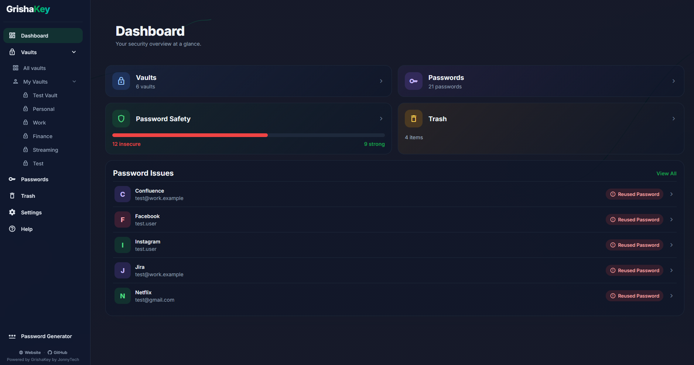
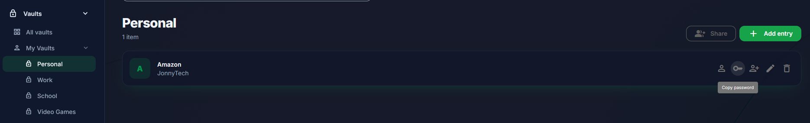
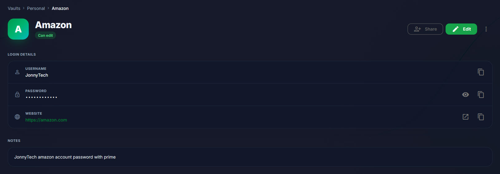
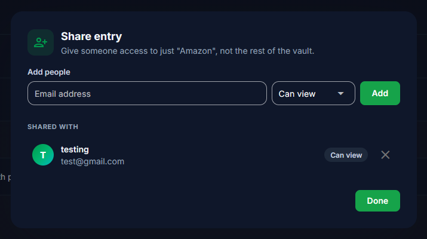
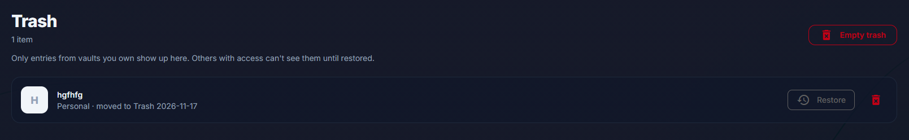
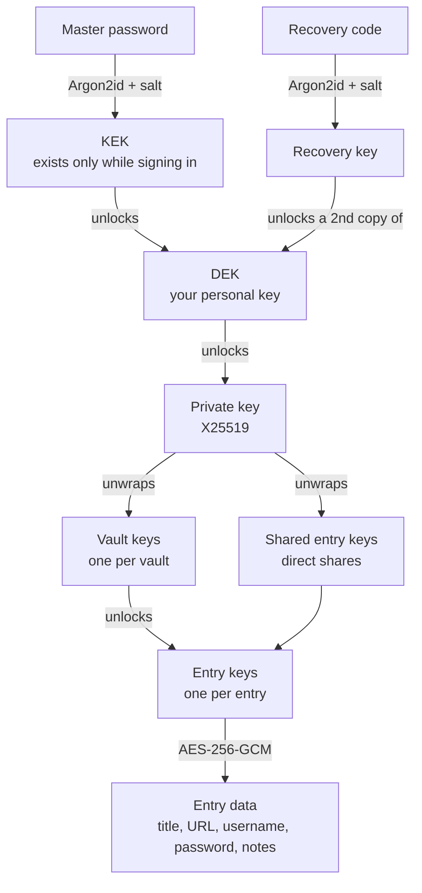
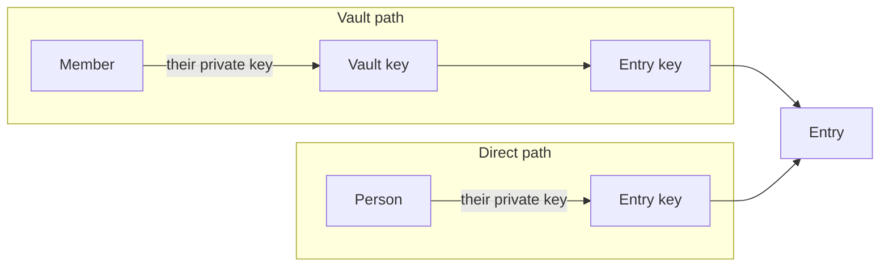
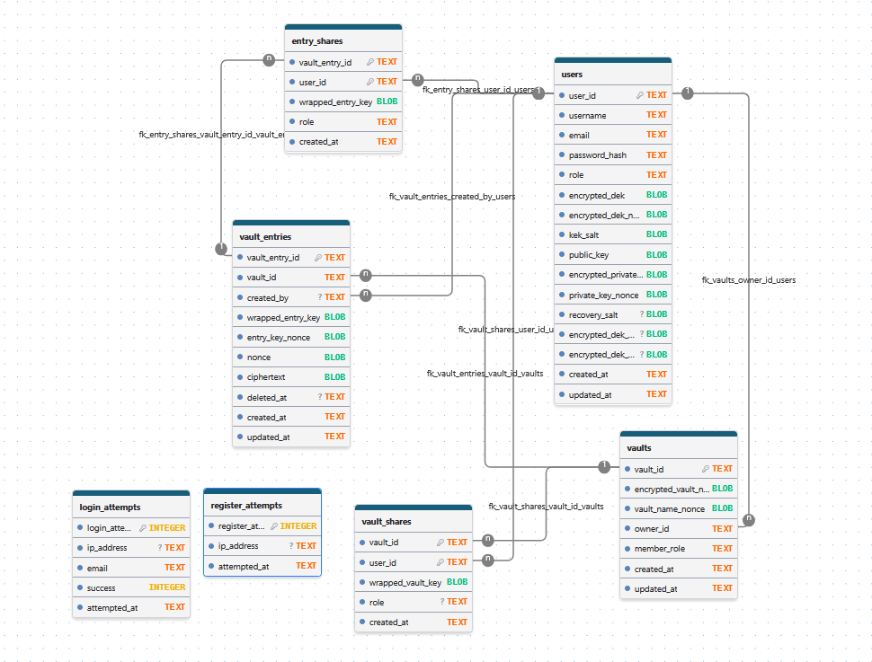
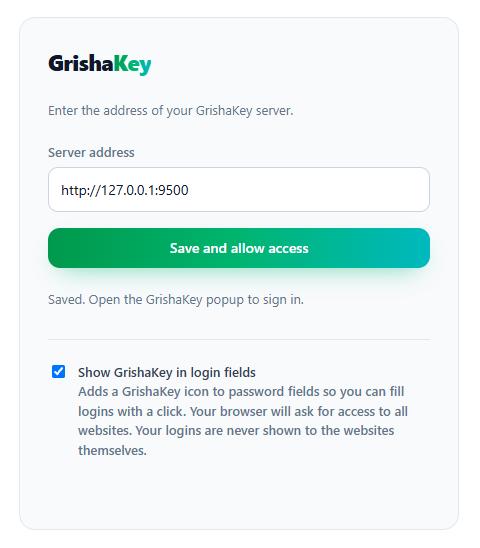
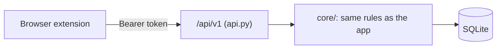

<div align="center">


[🌐 Website](https://grishakey.jonnytech.dev) · [💻 GitHub](https://github.com/jonnytech-dev/grishakey) · [JonnyTech](https://jonnytech.dev)

**A self-hosted password manager for teams, families, and organizations.**
Encrypted vaults, simple sharing, and a clean interface, built in Python.

<!-- SCREENSHOT: hero image (dashboard). Save as docs/screenshots/dashboard.png -->


</div>

---

## Contents

- [What it is](#what-it-is)
- [Features](#features)
- [Screenshots](#screenshots)
- [Tech stack](#tech-stack)
- [How the encryption works](#how-the-encryption-works)
- [How sharing works](#how-sharing-works)
- [Database schema](#database-schema)
- [Getting started](#getting-started)
- [Run with Docker](#run-with-docker)
- [Browser extension](#browser-extension)
- [Configuration](#configuration)
- [API](#api)
- [Project structure](#project-structure)
- [Tests](#tests)
- [Security notes](#security-notes)
- [Credits](#credits)
- [License](#license)

---

## What it is

GrishaKey stores passwords in **vaults**. You can keep a vault to yourself, or share it with a group so everyone in it can open the same logins. You can also share a single login with one person.

Everything is **encrypted before it's saved**. The database only holds locked data, and your master password is never stored.

It runs on your own server, and the app name can be changed with a setting, so an organization can run it under its own brand.

---

## Features

| | |
|---|---|
| 📊 **Dashboard** | Cards for your vaults, passwords, password safety, and Trash, plus the logins that need attention |
| 🔐 **Vaults** | Personal vault on sign-up, unlimited extra vaults, rename, search |
| 👥 **Sharing** | Share a vault with a group, or one entry with one person. Roles: Owner, Can edit, Can view |
| 🔄 **Key rotation** | Removing someone from a vault makes a new vault key, and unsharing an entry makes a new entry key, so their old copy stops working |
| 🔑 **Passwords page** | Every login you can open in one list, with search, "Shared with me" and "Needs attention" filters, and A–Z sort |
| 🩺 **Password health** | Finds weak, reused, and not-strong-enough passwords. Common words stay weak even with numbers or symbols added |
| 🗑️ **Trash** | Move to Trash, restore, delete forever, or empty the trash |
| 🎲 **Password Generator** | Passwords (8–100 characters, choose character types) or passphrases, with a strength meter |
| 📥 **Import & export** | Export to CSV (asks for your master password). Import CSV files from most password managers (up to 2 MB) |
| 🧾 **Recovery code** | A one-time code to reset a forgotten master password without losing data |
| 📋 **Safe copy** | Copied passwords are cleared from the clipboard after 30 seconds |
| ⚙️ **Settings** | Change username, email, and master password, create a new recovery code, import and export |
| 🌗 **Themes** | Light, dark, or match the system |
| 📱 **Phone layout** | On small screens, a bottom tab bar: Dashboard, Vaults, Passwords, Trash, and More |
| 🧩 **Browser extension** | Fill and save logins in Chrome, Edge, and Brave. See [Browser extension](#browser-extension) |
| ❔ **Help page** | Short guides, diagrams, and FAQ inside the app |
| 🏷️ **White-label** | Set the app name with `APP_NAME` and `APP_NAME_ACCENT` |

---

## Screenshots

<!-- Replace each image with your own screenshot. Suggested size: 1600px wide. -->

| Sign in | Dashboard |
|---|---|
|  | <!-- SCREENSHOT: dashboard. Save as docs/screenshots/dashboard.png -->  |

| Vault | Credential |
|---|---|
|  |  |

| Passwords | Sharing |
|---|---|
|  |  |

| Password Generator | Settings |
|---|---|
|  |  |

| Trash | Help |
|---|---|
|  |  |

| Dark mode |
|---|
| <!-- SCREENSHOT: any page in dark mode. Save as docs/screenshots/dark-mode.png -->  |

---

## Tech stack

| Layer | Tools |
|---|---|
| Language | Python 3.14 |
| Web UI | [NiceGUI](https://nicegui.io) (built on FastAPI) |
| API for the extension | FastAPI routes under `/api/v1` |
| Database | SQLite |
| Password hashing and key derivation | Argon2id (`argon2-cffi`) |
| Encryption | AES-256-GCM, X25519, HKDF (`cryptography`) |
| Browser extension | Manifest V3, plain JavaScript |
| Tests | pytest |

---

## How the encryption works

Every piece of data is locked by a key, and that key is locked by another key, up to your master password.



**The short version:**

| Key | What it locks | How it's stored |
|---|---|---|
| **Master password** | Your DEK (through the KEK) | Never stored. Only an Argon2id hash for sign-in |
| **DEK** | Your private key | Locked with the KEK (and a 2nd copy with the recovery key) |
| **Private key** (X25519) | Your copies of vault keys and shared entry keys | Locked with the DEK |
| **Vault key** | Every entry key in that vault, and the vault's name | One locked copy per member, made with their public key |
| **Entry key** | One entry's data | Locked with the vault key, plus one copy per direct share |

**Details**

- **AES-256-GCM** for all data. Every encryption uses a fresh 12-byte nonce, and the built-in tag catches any tampering.
- **Labels (AAD)** tie each locked value to its place, like `entry:<id>:ciphertext` or `vault:<id>:user:<id>`. Swapping data between rows fails to decrypt.
- **Public-key wrapping:** sharing a key with someone uses a throwaway X25519 key pair, a key exchange with their public key, HKDF, then AES-GCM. Only their private key can open it.
- **Changing your master password** re-locks the same DEK with a new key. Nothing else is re-encrypted, and your recovery code still works.
- **Recovery code:** 24 random characters (about 120 bits). Only a locked copy of the DEK is stored, never the code. Using it issues a new one.

---

## How sharing works

There are two ways to reach an entry:



| Action | What happens |
|---|---|
| **Add someone to a vault** | The owner unlocks the vault key and locks a copy for the new member's public key |
| **Share one entry** | The owner locks a copy of that entry's key for the person's public key |
| **Remove someone from a vault** | Their copy is deleted, a **new vault key** is made, and every entry key is re-locked with it |
| **Unshare an entry** | Their copy is deleted, a **new entry key** is made, and the entry is re-encrypted |

**Roles**

| Role | Can do |
|---|---|
| Owner | Everything: add and remove people, share, rename, move to Trash, restore, delete |
| Can edit | Add and change entries |
| Can view | See and copy entries |

---

## Database schema

<!-- SCREENSHOT: schema diagram exported from ChartDB. Save as docs/schema.png -->


The tables are created by `create_tables()` in [`core/storage.py`](core/storage.py).

| Table | Holds |
|---|---|
| `users` | Account, password hash, locked DEK, public key, locked private key, recovery copy |
| `vaults` | Encrypted vault name, owner, default member role |
| `vault_shares` | Who's in each vault, their locked copy of the vault key, optional role override |
| `vault_entries` | Encrypted entry data, its entry key locked with the vault key, Trash time |
| `entry_shares` | Entries shared directly, with a locked copy of the entry key per person |
| `login_attempts` | Sign-in attempts, for lockout |
| `register_attempts` | Sign-up attempts, for rate limiting |

---

## Getting started

**1. Clone and install**

```bash
git clone https://github.com/jonnytech-dev/grishakey.git
cd grishakey
python -m venv .venv
.venv\Scripts\activate          # Windows
# source .venv/bin/activate     # macOS / Linux
pip install -r requirements.txt
```

**2. Set your storage secret**

Generate one (it must be at least 32 characters; this makes 64):

```bash
python -c "import secrets; print(secrets.token_urlsafe(48))"
```

`main.py` reads its settings from environment variables. It doesn't load `.env` by itself, so set the secret in the terminal you run it from:

```bash
$env:STORAGE_SECRET = "paste-it-here"      # Windows PowerShell
# export STORAGE_SECRET="paste-it-here"    # macOS / Linux
```

For Docker, put it in `.env` instead (see [Run with Docker](#run-with-docker)).

**3. Run**

```bash
python main.py
```

Open **http://127.0.0.1:9500** and create an account. Save your recovery code when it's shown.

---

## Run with Docker

`compose.yaml` builds the image from the `Dockerfile` and runs it.

| | |
|---|---|
| User | Runs as a normal user (`grishakey`, uid 1000), never root |
| Port | `127.0.0.1:9500`, so only this computer can reach it |
| Data | The database and NiceGUI storage live in the `grishakey-data` volume (`/data`) and survive rebuilds |
| Settings | Read from `.env` (never copied into the image) |
| Hardening | `no-new-privileges`, all Linux capabilities dropped, a health check on the sign-in page |

**1. Create your `.env`**

```bash
cp .env.example .env
```

Put a generated secret after `STORAGE_SECRET=` (see step 2 above).

**2. Start it**

```bash
docker compose up -d --build
```

Open **http://127.0.0.1:9500**.

> **Note:** the `Dockerfile` sets `GRISHAKEY_HOST=0.0.0.0` and `GRISHAKEY_PORT=9500`, but `main.py` doesn't read them yet. It always listens on `127.0.0.1:9500`, which inside a container can't be reached through the published port.

**Back up the data**

```bash
docker compose stop
docker run --rm --volumes-from grishakey -v "${PWD}:/backup" alpine tar czf /backup/grishakey-backup.tgz -C /data .
docker compose start
```

The backup holds your encrypted database. Keep it somewhere safe, and never commit it (`*.tgz` is in `.gitignore`).

**Update**

```bash
git pull
docker compose up -d --build
```

**Other devices:** to reach it from other devices, put a reverse proxy with HTTPS (Caddy, Nginx, Traefik) in front of it. If you change the port to `"9500:9500"`, use HTTPS.

---

## Browser extension

The GrishaKey extension finds your logins for the site you're on, fills them with a click,
and lets you save new ones without opening the app. It works in Chrome, Edge, and Brave.

### What it does

- Shows your logins for the current site, with copy username and copy password
- Optional GrishaKey icon in login fields: click it, pick a login, and it's filled in
- Sign in right from the login field
- Create and edit logins, with the password generator (characters or words)
- Move logins to the Trash (vault owners) and rename vaults
- Light and dark theme

### Screenshots

| Popup | Fill from login fields |
|---|---|
|  |  |
|  |  |

### Before you start

Your GrishaKey server must be running, and you need an account on it.
- Running it on this computer: the address is `http://127.0.0.1:9500`
- Running it on a server: use its **https://** address (the extension requires HTTPS for anything
  that isn't on your own computer)

### Option 1: Chrome Web Store

Not available yet. When it is, install it from the store page and skip to
[Connect it to your server](#connect-it-to-your-server).

<!-- When published, replace the line above with:
Install it from the [Chrome Web Store](https://chromewebstore.google.com/detail/YOUR-EXTENSION-ID).
It works in Chrome, Edge, and Brave, and updates automatically. -->

### Option 2: Load it yourself (Developer mode)

1. **Get the files.** Either clone the repo:
   ```bash
   git clone https://github.com/jonnytech-dev/grishakey.git
   ```
   or on GitHub click **Code → Download ZIP** and unzip it.
   The extension is the `extension` folder inside.
2. **Open your browser's extensions page:**
   - Chrome: `chrome://extensions`
   - Edge: `edge://extensions`
   - Brave: `brave://extensions`
3. Turn on **Developer mode** (top-right corner; in Edge, it's in the left sidebar).
4. Click **Load unpacked** and select the `extension` folder.
5. **Pin it:** click the puzzle-piece icon in the toolbar, then the pin next to GrishaKey.

Keep the `extension` folder where it is. The browser loads it from that spot, so moving or
deleting it removes the extension.

### Connect it to your server

1. Right-click the GrishaKey icon → **Options** (or click the icon and choose **Open settings**).
2. Enter your server address, for example `http://127.0.0.1:9500`.
3. Click **Save and allow access**, then **Allow** in the browser's prompt.
4. Click the GrishaKey icon and sign in with your email and master password.

### Turn on filling from login fields (optional)

1. Open the extension's **Options**.
2. Check **Show GrishaKey in login fields**, then **Allow** in the browser's prompt.
3. Reload any open login pages.

A GrishaKey icon now appears in password fields. Click it, pick a login, and it's filled in.
The browser asks for access to all websites because the icon has to appear on them.
The websites themselves never see your logins.

### How it stays safe

- Your sign-in token is kept in memory only, and ends after 15 minutes without use.
- Logins only show on their own site. Lookalike domains (like `githuub.com`) never match.
- Passwords are fetched one at a time, only when you click.
- The list of logins is drawn by the extension in a sealed frame the website can't read.
- Filling only happens when you click, only into visible fields.
- It only sends your data to the server you set. Filling from login fields adds access to websites
  so the icon can appear on them, but nothing is sent to those websites.

### Updating (Developer mode)

Get the newest files (`git pull`, or download the ZIP again into the same folder), then click the
**reload** arrow on GrishaKey's card on the extensions page.

### If something doesn't work

| Problem | Fix |
|---|---|
| "Can't reach your GrishaKey server" | Make sure the server is running, and check the address in Options. |
| "Incorrect email or password" | Check your details. After too many tries, sign-in locks for 15 minutes. |
| No logins show for a site | The login's **Website** field must be filled in (for example `https://github.com`). |
| No icon in login fields | Turn it on in Options, then reload the page. |
| Signed out on its own | Sessions end after 15 minutes of inactivity, or when you change your master password. |

---

## Configuration

Settings are environment variables. Docker Compose reads them from `.env`. For `python main.py`, set them in your terminal.

| Variable | Required | Default | What it does |
|---|---|---|---|
| `STORAGE_SECRET` | ✅ | | Signs the session cookie. At least 32 characters, or the app won't start |
| `GRISHAKEY_DATA` | | `./data` | Folder for the database file (`grishakey.db`). Docker sets `/data` |
| `APP_NAME` | | `Grisha` | Plain part of the app name |
| `APP_NAME_ACCENT` | | `Key` | Part of the name shown in the gradient. Both parts together: 40 characters at most |
| `USER_DIRECTORY` | | `false` | Show a searchable user list in share dialogs. Only turn on for a single organization |
| `NICEGUI_STORAGE_PATH` | | `./.nicegui` | Where NiceGUI keeps its per-browser storage (read by NiceGUI). Docker sets `/data/.nicegui` |

Generate a secret with:

```bash
python -c "import secrets; print(secrets.token_urlsafe(48))"
```

The app listens on `127.0.0.1:9500`. `GRISHAKEY_HOST` and `GRISHAKEY_PORT` (set in the `Dockerfile`) aren't read by `main.py` yet.

---

## API

The browser extension talks to a small JSON API at `/api/v1`. It's versioned, so older extensions keep working when the API changes later.



Every route except `/login` needs an `Authorization: Bearer <token>` header. (`/logout` just ends the token you send.) The server checks every rule again: edit rights, owner-only actions, and duplicate names.

| Method | Path | What it does |
|---|---|---|
| `POST` | `/api/v1/login` | Sign in with email and master password. Returns a token. Same lockout and errors as the web sign-in |
| `POST` | `/api/v1/logout` | Ends the token |
| `GET` | `/api/v1/logins?url=...` | Logins that match a page: title, username, vault, `can_edit`, `can_delete`. Never passwords |
| `POST` | `/api/v1/logins` | Create a login in a vault you can edit |
| `GET` | `/api/v1/logins/{id}` | One login's details for the edit form. No password |
| `PUT` | `/api/v1/logins/{id}` | Edit a login (needs edit rights) |
| `DELETE` | `/api/v1/logins/{id}` | Move a login to the Trash (vault owner only) |
| `GET` | `/api/v1/logins/{id}/password` | One password, sent with `Cache-Control: no-store` |
| `GET` | `/api/v1/vaults` | Your vaults, with `can_edit` and `is_owner` |
| `POST` | `/api/v1/vaults` | Create a vault |
| `PATCH` | `/api/v1/vaults/{id}` | Rename a vault (owner only) |
| `GET` | `/api/v1/generate` | A random password: `length` 8–100, `upper`, `lower`, `digits`, `symbols` |
| `GET` | `/api/v1/generate-passphrase` | A passphrase: `words` 3–12, `separator`, `capitalize`, `number` |

---

## Project structure

```
grishakey/
├── core/
│   ├── crypto.py        # hashing, key derivation, AES-GCM, X25519 wrapping, labels
│   ├── storage.py       # all SQL: tables, migrations, reads, writes
│   ├── auth.py          # register, login, lockout, profile, password change, recovery
│   ├── vault.py         # entries: add, read, list, update, trash
│   ├── sharing.py       # vaults, members, direct shares, key rotation
│   ├── sessions.py      # in-memory sessions with idle timeout and maximum lifetime
│   ├── generator.py     # password and passphrase generator
│   ├── health.py        # password health: weak, reused, not strong enough
│   ├── match.py         # does a saved login's site match a page? (for the extension)
│   ├── transfer.py      # CSV import and export
│   ├── models.py        # dataclasses
│   └── wordlists/       # EFF large wordlist for passphrases
├── extension/           # browser extension (Manifest V3)
│   ├── manifest.json
│   ├── background.js    # holds the token, talks to the API, checks every message
│   ├── popup.html/.js   # toolbar popup: logins, new and edit form, vaults
│   ├── content.js       # in-page icon and filling (only if turned on)
│   ├── inline.html/.js  # the dropdown under a login field (a sealed extension frame)
│   ├── menu.js          # ⋮ menu and confirm box
│   ├── options.html/.js # server address and the in-page icon setting
│   ├── theme.js, style.css, inline.css
│   ├── icons/
│   └── README.md
├── tests/               # pytest suite
├── assets/              # backgrounds, favicon
├── docs/                # screenshots and schema image
├── main.py              # NiceGUI pages and app startup
├── api.py               # JSON API for the extension (/api/v1)
├── Dockerfile
├── compose.yaml
├── .dockerignore
├── .env.example
├── .gitignore
├── LICENSE
└── requirements.txt
```

`core/` holds all the security logic and has no UI code. `main.py` and `api.py` only build pages and routes and call into `core/`.

---

## Tests

```bash
python -m pytest -v
```

The suite covers encryption, labels and tamper detection, login lockout and timing, SQL injection and access checks, roles, sharing, key rotation (old keys stop working), Trash, recovery codes, the generator, password health, site matching, CSV import and export, sessions (timeout, lifetime, sign-out on password change), the API, and startup checks and security headers.

---

## Security notes

- **The server decrypts while you're signed in.** Your private key stays in server memory only during your session, and is dropped on logout. Run GrishaKey on a server you trust.
- **Sessions end on their own:** after 15 minutes without use, and after 12 hours at most, even while in use. This applies to the web app and the extension.
- **Changing your master password or using a recovery code signs out everywhere:** every browser and the extension.
- **Sign-in lockout:** 10 failed tries within 15 minutes, per email or per IP address, locks sign-in and recovery. Wrong email and wrong password give the same error.
- **Security headers** on every response: `X-Frame-Options: DENY` (other sites can't frame the app), `X-Content-Type-Options: nosniff`, `Referrer-Policy: no-referrer`, and a `Permissions-Policy` that turns off camera, microphone, and location.
- **A strong `STORAGE_SECRET` is required.** The app won't start with one shorter than 32 characters.
- **Anti-phishing site matching:** the extension only offers a login on its own site or a subdomain of it (`github.com` matches `gist.github.com`). Lookalike domains like `githuub.com` never match.
- **Use HTTPS** in front of it in production. The clipboard feature also needs HTTPS outside of `localhost`.
- **Removing someone** changes the keys, but they may remember passwords they already saw. Change important ones.
- **Exported CSV files are not encrypted.** Delete them after use (`*.csv` is in `.gitignore`).
- **Forgot your master password and lost your recovery code?** The data can't be recovered by anyone. That's by design.
- **Never commit `.env`** or the `data/` folder.

---

## Credits

- Passphrases use the [EFF Large Wordlist](https://www.eff.org/dice) by the Electronic Frontier Foundation, licensed under [CC BY 3.0 US](https://creativecommons.org/licenses/by/3.0/us/).
- Built by [JonnyTech](https://github.com/jonnytech-dev) · [Website](https://jonnytech.dev)

---

## License

GrishaKey is released under the [GrishaKey License 1.0](LICENSE).

- ✅ Use it for anything, including commercial use
- ✅ Change it, share it, or sell it, with no need to publish your changes
- ✅ Show your organization's name with `APP_NAME`
- 📢 Keep **"Powered by GrishaKey by JonnyTech"** visible at the bottom of the navigation
  and on the sign-in and sign-up pages, linked to [jonnytech.dev](https://jonnytech.dev)
